# Kvist & Bjælke login platform

# CDS.security

## The platform

A web app where employees log in with a username and password and see a table of users. What else they can do depends on their role.

| Role | Can do |
|---|---|
| user | Read the users table |
| superuser | Read, and create, edit and delete users with the role user |
| admin | Read, and create, edit and delete everyone |

Users can't sign up on their own. The first admin comes from settings when the app starts. After that, only a logged-in superuser or admin can add people.

## Screenshots

These are from the client VM on VLAN 570.

The login page:

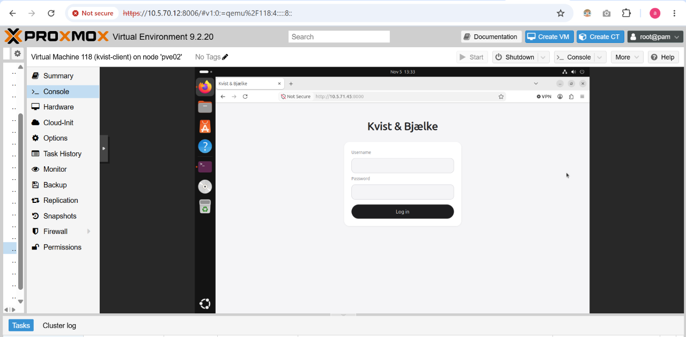

A wrong password gives an error:

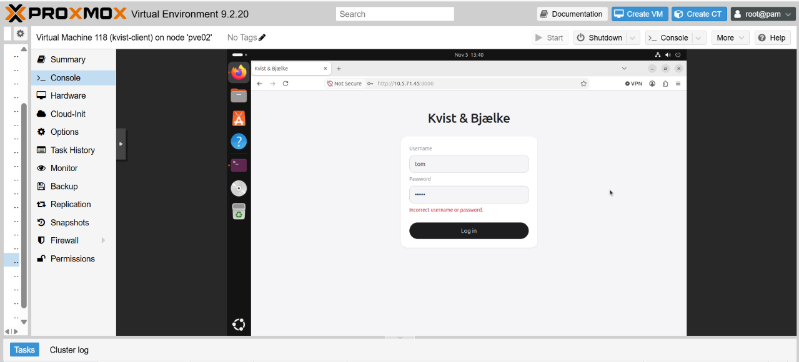

An admin has buttons on everyone, but can't delete their own account:

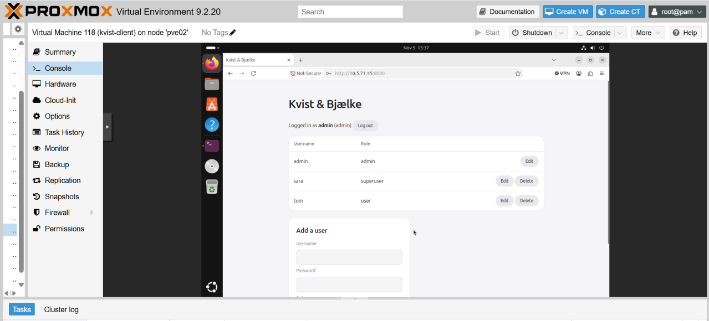

A superuser only has buttons on users:

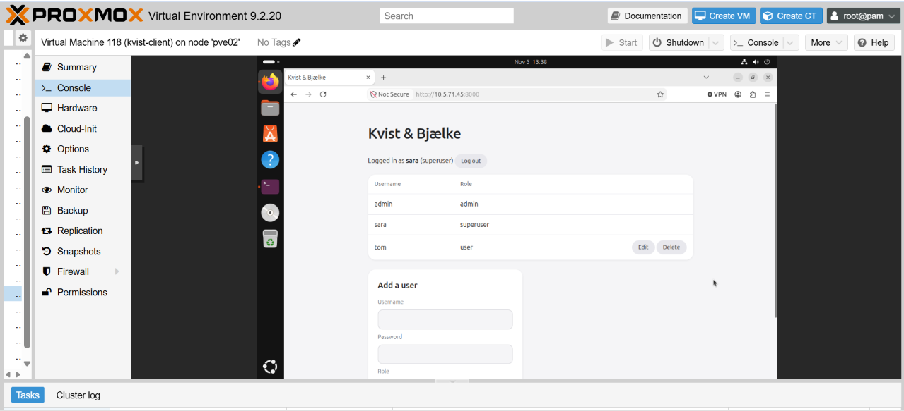

A user only sees the table:

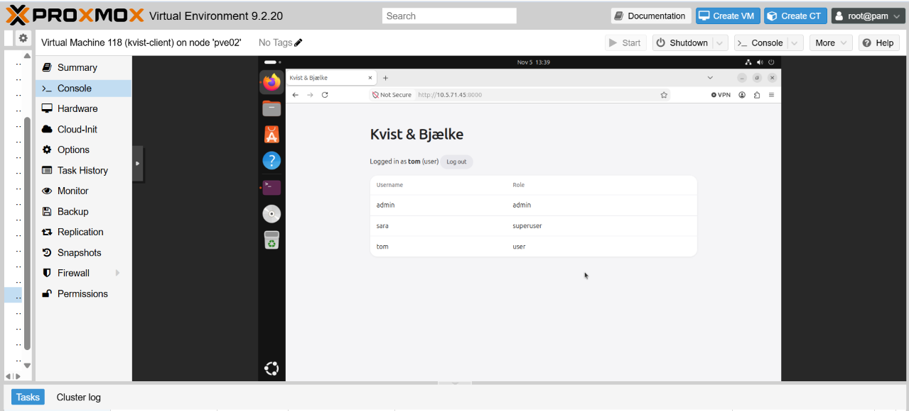

## Technology

| Part | Choice | Why |
|---|---|---|
| Backend | C#, ASP.NET Web API, .NET 10 | JWT and role checks are built in |
| Frontend | React, TypeScript, Bun | Types catch mistakes before the page runs |
| Database | SQLite with EF Core | One file and no extra server. EF Core sends values as parameters, which protects against SQL injection |
| Hosting | Docker Compose | Runs the same on a developer's PC and on the server |

## Security features

### Passwords

- Passwords are hashed with Argon2id: 64 MB of memory, 3 iterations, parallelism 4.
- Every password gets its own random 16-byte salt, so two users with the same password get different hashes.
- The database only stores `hash.salt`, never the password.
- The API never sends the hash back. Responses only have id, username and role.

### Login

- A correct login returns a JWT signed with HS256. It holds the user id and role, and it expires after 1 hour.
- A wrong username and a wrong password give the same error, so the page doesn't show which usernames exist.
- The token is kept in sessionStorage, and logging out removes it.

### Roles

- No token or a bad token gives 401. A forbidden action gives 403.
- One small method, `RoleRules.CanChange`, decides who may change whom. It checks the role of the person being changed, not only that the user is logged in.
- An edit checks both the person's current role and the new role, so a superuser can't make someone an admin.
- The server reads the user's role from the database on every request, so a lowered role or a deleted account counts right away.
- Users can't delete themselves or change their own role, so there is always an admin left.
- The page hides buttons the user can't use, but the server makes the final decision.

### Secrets

- The JWT secret and first admin password are in `.env`, which git ignores.
- The container runs as a normal user, not root.
- The OpenAPI page is only on in development.

## Alternatives

| Chosen solution | Alternative | Why |
|---|---|---|
| Hashing with Argon2id | scrypt, bcrypt or PBKDF2 | Argon2id is usually ranked first, because cracking it takes a lot of memory as well as time |
| JWT for login | Sessions stored on the server | With sessions the server can end a login at once. A JWT keeps working until it expires, even after logout, but the server doesn't have to store it |
| Plain HTTP in the lab | HTTPS | HTTP sends passwords and tokens unencrypted over the network, so a real company would need HTTPS |
| SQLite | PostgreSQL | PostgreSQL handles many users at the same time better, but SQLite is enough for this small platform |
| One container for the page and API | A separate container for each | One container needs only one port and no CORS setup. Separate containers could be scaled on their own |

# CDS.infrastructure

## IP plan

The company network is split into VLANs, so each type of device has its own network. All addresses are private (10.x.x.x). VLAN 570 and 571 were given, and the same pattern is used for the rest.

| VLAN | Network | Gateway | Devices | Addresses | Why it's separate |
|---|---|---|---|---|---|
| 570 Clients | 10.5.70.0/24 | 10.5.70.5 | 15 desktops, 10 laptops | DHCP | Normal work |
| 571 Servers | 10.5.71.0/24 | 10.5.71.5 | 3 servers | Static | Valuable data |
| 572 Printers | 10.5.72.0/28 | 10.5.72.5 | 3 printers | Static | Often poorly secured |
| 573 Phones | 10.5.73.0/27 | 10.5.73.5 | 12 IP phones | DHCP | Calls need priority |
| 574 Cameras | 10.5.74.0/28 | 10.5.74.5 | 6 cameras | Static | Private video |
| 575 Guests | 10.5.75.0/24 | 10.5.75.5 | Visitors' devices | DHCP | Can't be trusted |
| 576 Management | 10.5.76.0/27 | 10.5.76.5 | Access points, switches, router, firewall | Static | Only IT should reach it |

Devices that others must always find get static addresses. Devices that come and go use DHCP.

## Subnetting

| Network | Address | Mask | Hosts | Devices today |
|---|---|---|---|---|
| Phones | 10.5.73.0 | 255.255.255.224 (/27) | 30 | 12 |
| Cameras | 10.5.74.0 | 255.255.255.240 (/28) | 14 | 6 |

Both sizes fit today's devices, with room to double them and still have an address for the gateway. Clients and guests get a /24 with 254 hosts, because their numbers change the most.

## Network diagram

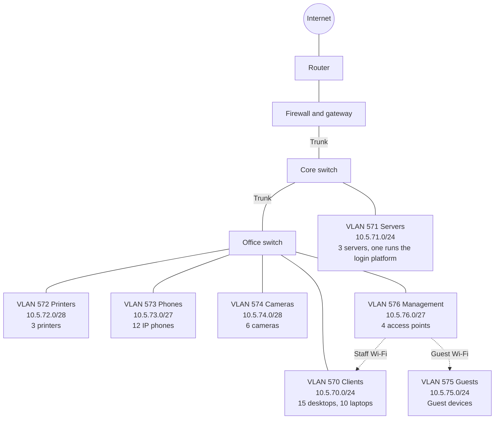

## Firewall and VLANs

**Why are VLAN 570 and 571 separate?** So a client with malware isn't on the same network as the servers.

**Why does traffic between VLANs need routing?** Each VLAN is its own network, so a switch can't pass traffic between them. The gateway routes it.

**What does the firewall do?** Traffic between the VLANs goes through it, and it decides what is allowed. Here it allows VLAN 570 to reach VLAN 571 on TCP 8000-8100.

**Why allow only specific ports?** Every open port is a possible way in, so only the ports the platform needs are open.

## Server on VLAN 571

A VM in Proxmox with Ubuntu Server 26.04.1, 2 cores, 4096 MB of memory and a 32 GB disk, on the bridge VLAN571.

Ubuntu Server is installed:

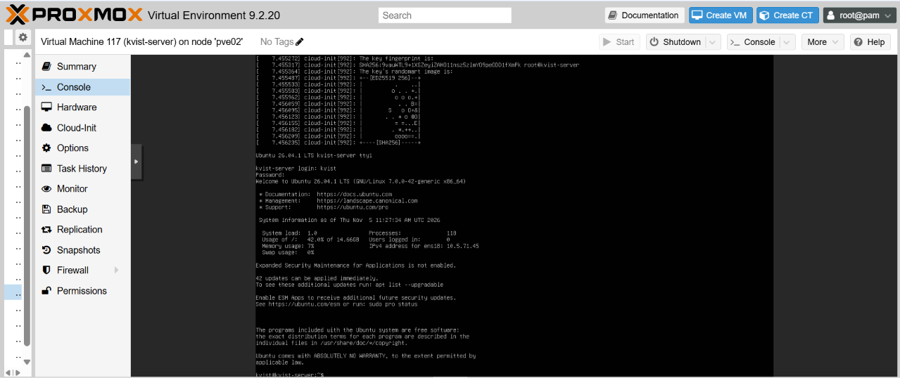

The server got 10.5.71.45/24 from DHCP, with gateway 10.5.71.5. In production it would be static, as in the IP plan.

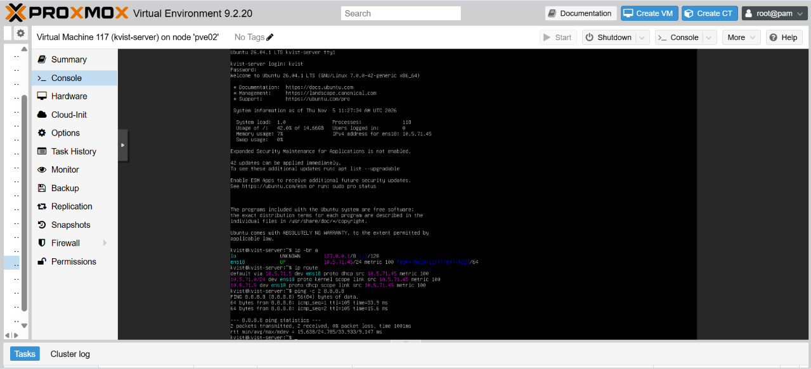

Docker was installed with `sudo apt install docker.io docker-compose-v2`, and hello-world confirms that it works:

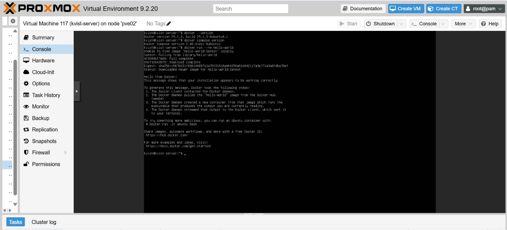

The repo was cloned, a `.env` file was created and `docker compose up -d --build` was run. The platform runs in a container:

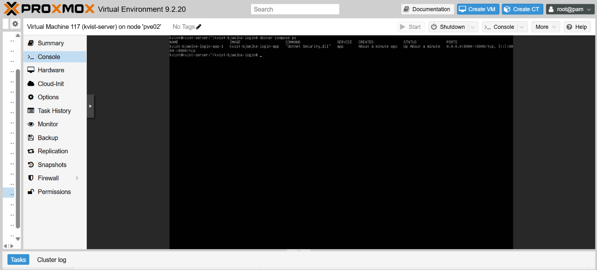

Port 8000 was chosen, as it is the first port in the range the firewall allows. The platform answers on it:

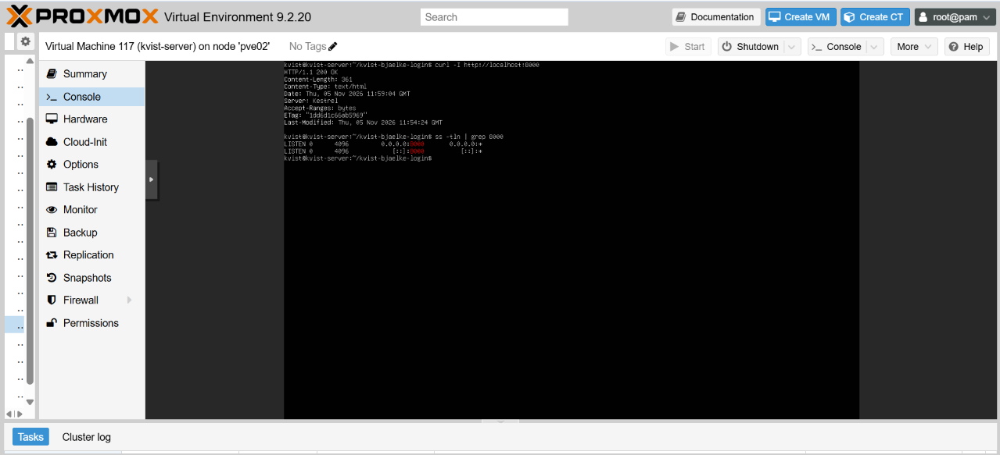

## Client on VLAN 570

A second VM with Ubuntu Desktop 26.04.1, so it has a browser, on the bridge vmbr0. It got 10.5.70.115/24 from DHCP, with gateway 10.5.70.5.

The connection to the server was then tested:

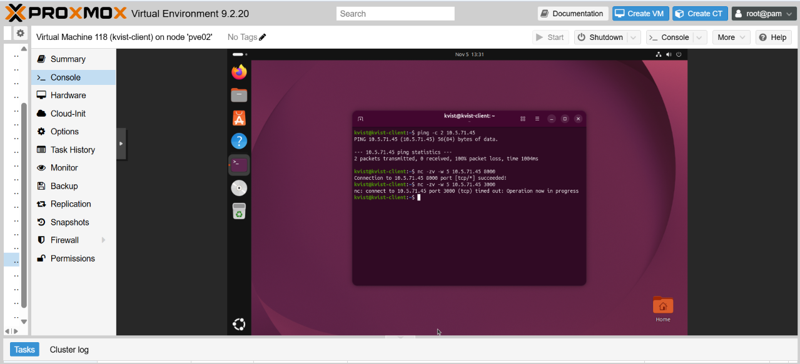

| Test | Result |
|---|---|
| Ping | No answer |
| TCP port 8000 | Connected |
| TCP port 3000 | Timed out, so the firewall dropped it |

The platform works from the client at http://10.5.71.45:8000. The screenshots under CDS.security are from this client, and they show the login and all 3 roles.

## Problems and solutions

| Problem | Solution |
|---|---|
| Docker gave "permission denied" after the user was added to the docker group | Logging out and in again applied the change |
| Proxmox had no VLAN570 bridge | vmbr0 without a tag was used, and `ip -br a` confirmed a 10.5.70.x address |
| `curl` gave a TLS error on port 8000 | The platform uses plain HTTP, so the address needed `http://`, not `https://` |

# Final reflection

**How are security and infrastructure connected?** The firewall limits clients to the platform's port, and the platform then checks who they are and what they may do. Hashing protects stored passwords, but plain HTTP still exposes them on the network, so the app and the network depend on each other.

**What were the technical challenges?** Mostly the lab, as the table above shows: Docker permissions, finding the right network bridge and using the right address.

**What was learned about deploying on a server?** The same container ran on the VM without code changes, and secrets stayed in `.env`. A failed ping doesn't mean a service is down, so the port itself must be tested.

**What would change in a real company?** HTTPS, a static server address, limits on login attempts, password rules, PostgreSQL and backups.

## References

Anthropic. (2026). Claude (claude-opus-5-5) [Large language model]. https://claude.ai

Used as a helper during this assignment, as it was completed by one person.

## Appendix: Group contract

The assignment was completed by one person, so there is no group contract.
